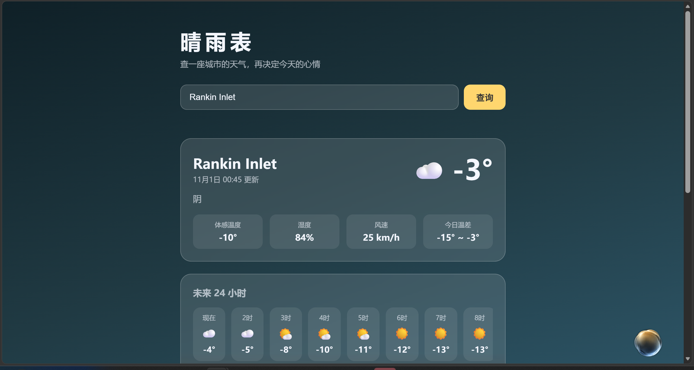

# 晴雨表 · Weather Now 🌤️

一个简洁好看的天气查询网页，输入城市名即可查看**实时天气、未来 24 小时预报和 7 天趋势**，页面背景还会随天气自动变色。

> 我的第一个 GitHub 项目，欢迎 Star ⭐

## ✨ 功能

- 🔍 城市搜索，支持中英文（带候选列表，不怕重名城市）
- 🌡️ 实时温度、体感温度、湿度、风速、当日温差
- ⏰ 未来 24 小时逐小时预报
- 📅 未来 7 天预报 + 温度区间可视化条
- 🎨 背景主题随天气自动切换（晴 / 多云 / 雨 / 雪 / 夜）
- 📱 移动端自适应

## 🛠️ 技术栈

- 原生 **HTML + CSS + JavaScript**，零框架，适合学习
- 构建工具：[Vite](https://vitejs.dev/)
- 数据源：[Open-Meteo](https://open-meteo.com/) —— 免费开源天气 API，**无需 API Key**

## 🚀 本地运行

```bash
# 克隆项目
git clone https://github.com/你的用户名/weather-now.git
cd weather-now

# 安装依赖
npm install

# 启动开发服务器
npm run dev
```

浏览器打开终端里提示的地址（默认 http://localhost:5173）即可。

## 📦 构建部署

```bash
npm run build   # 产物在 dist/ 目录
```

`dist/` 是纯静态文件，可以直接部署到 **GitHub Pages**、Vercel、Netlify 等平台。

## 📸 截图

<!-- 运行后截一张图放在这里，例如： -->
<!--  -->

## 💡 实现思路

1. 调用 Open-Meteo 的 **Geocoding API** 把城市名转成经纬度；
2. 用经纬度请求 **Forecast API**，一次拿回当前、逐小时、逐日三组数据；
3. 按 [WMO 天气代码](https://open-meteo.com/en/docs) 映射成中文描述和 emoji；
4. 根据天气代码 + 昼夜标记切换页面渐变主题。

## 📄 License

[MIT](LICENSE)
